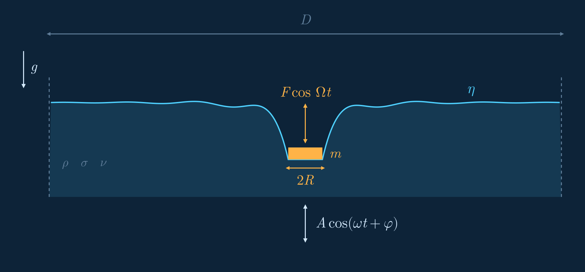

# km-disk-vibrating

[](https://github.com/elvis-aguero/km-disk-vibrating/actions/workflows/julia-ci.yml)
[](https://github.com/elvis-aguero/km-disk-vibrating/actions/workflows/matlab-ci.yml)



*A disk (radius R, mass m) floats on a fluid (ρ, σ, ν) shaken as A cos(ωt + φ); the disk can
also be forced directly with F cos Ωt. The solver computes the surface η and the disk's motion.
Rendered from a real run (vertical scale ×20) by `julia/scripts/make_setup_gif.jl`.*

Simulates a small disk floating on a fluid bath that is shaken up and down, and predicts
how much the disk bobs (amplitude) and how far it lags the bath (phase) at each shaking
frequency and strength. The predictions are compared against lab measurements in
`matlab/0_data/external/experimental_measurements/`.

There are two implementations of the same model: **Julia** (`julia/`, recommended,
tested, faster) and the original **MATLAB** (`matlab/`, kept as the reference).

## Start here

| I want to… | Go to |
|---|---|
| Try one simulation on my laptop (minutes) | [1. Install](#1-install-julia) → [2. One simulation](#2-one-simulation) |
| Reproduce the full sweep vs. experiment (hours, cluster) | [3. Full sweep](#3-full-sweep-vs-experiment-cluster) |
| Look at results that already exist | `output/README.md` (committed reference run + plots) |
| Use MATLAB instead | [MATLAB API](#matlab-api) |

### 1. Install (Julia)

Install Julia ≥ 1.10 (https://julialang.org/downloads/), then, from the repository root:

```sh
cd julia
julia --project=. -e 'using Pkg; Pkg.instantiate()'
```

### 2. One simulation

Save this as `try.jl` and run `julia --project=julia try.jl` from the repository root
(the first run also compiles Julia code, so allow a few minutes):

```julia
using FaradayDisk

Γ, f = 0.2, 30.0                      # bath acceleration (in g) and frequency (Hz)
params = SimulationParams(
    bathFrequency = f,
    bathAmplitude = Γ * 981 / (2π * f)^2,          # cm  (Γ = A·ω²/g)
    simulationTime = 30 / f,                       # s, upper bound; stops early once periodic
    bathDiameter = 20.0, spatialResolution = 5.0)  # small domain: runs in seconds

dtn = generate_dtn(50, params.bathDiameter)       # bath operator for this domain (nr = 50)
result = run_simulation(params; dtn = dtn)

z = lab_frame_CoM(result)                          # disk height as a camera in the lab sees it
last3 = result.t_s .>= result.t_s[end] - 3 / f          # fit the settled last 3 periods
fit = fit_oscillation(result.t_s[last3], z[last3], 2π * f)
println("disk/bath amplitude ratio = ", round(fit.amplitude / params.bathAmplitude, digits = 3))
```

This prints `disk/bath amplitude ratio = 1.119`. Every other parameter (disk size and mass, fluid
properties, resolution) has a default; see the [parameter table](#julia-api).

**Two things to know when reading results:**
- `result.CoM_cm` is the disk height **relative to the moving bath**. For comparison with
  lab/camera data use `lab_frame_CoM(result)`, which adds the bath's own motion back.
- The small domain above (`bathDiameter = 20`, `spatialResolution = 5`) is for trying
  things out. The validated results use `bathDiameter = 100`, `spatialResolution = 50`
  (`nr = 2500`), whose bath operator takes hours to build. The repo ships it as
  `matlab/1_code/D50Quant100/*.mat`, which step 3 loads for you.

### 3. Full sweep vs. experiment (cluster)

Runs the 30 cases (Γ ∈ {0.05, 0.2, 0.5} × f = 10…100 Hz) at the validated resolution and
compares them with the measurements:

```sh
sbatch julia/cluster/run_baseline_sweep.sh     # read its header first: partition/account/memory
```

Results land in `output/<job_id>_<timestamp>/`:
- `sweep/val_amp_sweep.png`, `sweep/val_phase_sweep.png`: simulation vs. experiment.
  One colour per Γ, frequency on the x-axis.
- `sweep/summary.csv`: one row per case.
- `sweep/cases/*.csv`: full time series per case.
- `logs/`: what happened, including any warnings.

The job prints `pass_primary = true` when the amplitude RMSE is ≤ 0.15 and the phase RMSE
is ≤ 8.55° (1.5× the known-good baseline). The committed reference run achieved 0.085 and
6.0°, with each case taking 116–203 s and 4 cases running at a time.

On a workstation instead of a cluster, run
`julia -t auto --project=julia/scripts julia/scripts/run_sweep.jl` (the scheduler budgets about
12 GB of RAM per concurrently running case at this resolution and queues the rest).

## Where things are

| Path | What it is |
|---|---|
| `julia/src/` | the simulator (package `FaradayDisk`). Entry points: `simulate.jl` (`run_simulation`), `sweep.jl` (`run_sweep`) |
| `julia/scripts/` | command-line tools: sweep, DTN generation, validation overlay, cluster baseline check |
| `julia/cluster/` | SLURM job script for the full sweep |
| `julia/test/` | tests (`unit/`, `integration/` run in CI; `slow/` opt-in, hours) |
| `matlab/1_code/simulation_code/` | original MATLAB solver (`solve_motion.m` + helpers) |
| `matlab/1_code/sweeper.m` | MATLAB sweep driver |
| `matlab/1_code/tests/` | MATLAB tests, including a live MATLAB↔Julia parity check |
| `matlab/1_code/D*Quant*/` | precomputed bath (DTN) operators, one folder per domain |
| `matlab/0_data/external/experimental_measurements/` | the lab measurements (amplitude, phase) |
| `matlab/0_data/sweep_results/` | historical MATLAB sweep output |
| `matlab/legacy_impact_study/` | unrelated material from a separate impact study, kept for reference |
| `output/` | cluster run output (see its README) |
| `docs/audit/` | code audit and benchmark scripts |
| `.github/workflows/` | CI: `julia-ci.yml`, `matlab-ci.yml` (MATLAB tests + live parity vs. Julia) |

## The physical model, in one place

Both implementations solve the same nondimensionalized problem:

- A disk of radius `diskRadius`, mass `diskMass`, floats on a circular bath of diameter
  `bathDiameter` (in disk radii), discretized with `spatialResolution` radial grid intervals per
  disk radius (`nr = ceil(spatialResolution * bathDiameter / 2)` total radial nodes).
- The bath surface response is governed by a dense DTN operator matrix, precomputed once per
  domain (see [The DTN operator](#the-dtn-operator) below) — this is the expensive part; solving it is a fast fixed-size
  linear system every time step.
- **Two independent forcing channels exist, and either or both can be active:**
  - **Disk forcing**: a sinusoidal force of amplitude `forceAmplitude` (dyne) and frequency
    `forceFrequency` (Hz) applied directly to the disk.
  - **Bath forcing**: the bath itself physically oscillates with amplitude `bathAmplitude` (cm)
    and frequency `bathFrequency` (Hz), `phaseDifference` (degrees) out of phase with the disk
    forcing.
  - **This experimental study's real convention is bath-driven**: `forceAmplitude = 0`, and
    `forceFrequency` is left at its default — it still sets the characteristic time unit
    (`T_unit = 1/forceFrequency`) even when it isn't a real force. `sweeper.m` / `run_sweep.jl`
    both use this convention. See [Forcing conventions](#forcing-conventions) below — getting this backwards
    silently produces a plausible-looking but physically wrong result, and it happened once.
- `startStatic` solves for hydrostatic equilibrium once at t=0 as the initial condition (instead
  of starting from rest), matching how the real apparatus is set up.
- `earlyStop` (+ its `minPeriods`/`windowPeriods`/`checkEveryPeriods`/`amplitudeRelTol`/
  `phaseAbsTolDeg` knobs) stops the simulation once the center-of-mass oscillation's fitted
  amplitude and phase are stable across two consecutive multi-period windows, rather than running
  the full `simulationTime` — see [The convergence check](#the-convergence-check) below.

### Forcing conventions

The solver works in the frame of the bath, which moves as
`z_bath(t) = bathAmplitude·cos(2π·bathFrequency·t + phaseDifference)`. In that frame the
bath's motion appears as an oscillating effective gravity `g·(1 − Γ·cos(…))`, with
`Γ = bathAmplitude·(2π·bathFrequency)²/g`. Consequences:
- The experiment is **bath-driven**: set `bathAmplitude`/`bathFrequency` and leave
  `forceAmplitude = 0`. Setting a disk force at the same Γ instead gives a plausible-looking
  but physically different answer; this happened once. `sweep_metadata.toml` records
  `is_bath_driven` for every sweep.
- Reported disk heights (`CoM_cm`) are relative to the bath; `lab_frame_CoM(result)` (Julia)
  adds `z_bath` back for comparison with the lab.
- `forceFrequency` only sets the internal time unit when `forceAmplitude = 0`; leave it at
  its default.

### The DTN operator

The bath surface outside the disk is coupled to the fluid below through a dense
Dirichlet-to-Neumann (DTN) matrix of size `nr × nr`, which depends only on the domain
(`bathDiameter`, `spatialResolution`). It is computed once per domain and cached:
- MATLAB: `matlab/1_code/D<…>Quant<…>/*.mat`.
- Julia: `julia/data/dtn_cache/`, filled from those `.mat` files by
  `julia/scripts/migrate_dtn_caches.jl`, or built natively with
  `julia/scripts/generate_dtn.jl` / `generate_dtn(nr, bathDiameter)`.

Cost grows as `nr³`: seconds for `nr = 50`, hours for the production `nr = 2500`.

### The convergence check

With `earlyStop = true`, a run stops once the disk's oscillation is periodic: amplitude and
phase are fitted over the last two `windowPeriods`-long windows, and the run stops when they
agree to within `amplitudeRelTol` / `phaseAbsTolDeg`, never before `minPeriods`. An older
check (stop when a rolling mean stops drifting) fired almost immediately because of the
static-equilibrium offset, and degraded agreement with the experiment by about 10×
(amplitude) and 50× (phase). The full story is in `julia/src/convergence.jl`.

## MATLAB API

### `solve_motion(...)` — `matlab/1_code/simulation_code/solve_motion.m`

```matlab
[t_s, CoM_cm, eta_history_cm] = solve_motion('name', value, ...)
```

All arguments are optional name-value pairs (a MATLAB `arguments` block); unless noted, units are
cgs.

| Name | Default | Units | Meaning |
|---|---|---|---|
| `diskRadius` | `0.2` | cm | disk radius |
| `diskMass` | `0.0283` | g | disk mass |
| `forceAmplitude` | `0` | dyne | disk-forcing amplitude |
| `forceFrequency` | `90` | Hz | disk-forcing frequency; also sets the characteristic time unit regardless of whether disk forcing is active |
| `bathAmplitude` | `0.01` | cm | bath-oscillation amplitude |
| `bathFrequency` | `90` | Hz | bath-oscillation frequency |
| `phaseDifference` | `-90` | degrees | phase of bath forcing relative to disk forcing |
| `bathDensity` | `1` | g/cm³ | fluid density |
| `bathSurfaceTension` | `72.20` | dyne/cm | fluid surface tension |
| `bathViscosity` | `0.978e-2` | Stokes | fluid kinematic viscosity |
| `g` | `981` | cm/s² | gravitational acceleration |
| `bathDiameter` | `100` | disk radii | bath domain diameter |
| `spatialResolution` | `50` | — | radial grid intervals per disk radius (`dr = 1/spatialResolution` disk radii; sets `nr`) |
| `temporalResolution` | `30` | — | time steps per dimensionless time unit |
| `simulationTime` | `10/90` | s | total time to simulate (upper bound if `earlyStop` fires first) |
| `debug_flag` | `false` | — | verbose logging, diary file and a live plot every step (slow) |
| `solverType` | `"auto"` | — | `"auto"` (LU-cached if RAM allows, else GMRES), `"lu"`, or `"gmres"` |
| `gmresTolerance` | `1e-10` | — | GMRES convergence tolerance (when GMRES is active) |
| `startStatic` | `true` | — | start from hydrostatic equilibrium instead of rest |
| `earlyStop` | `true` | — | enable the convergence-based early stop |
| `minPeriods` | `10.0` | forcing periods | never declare convergence before this many periods |
| `windowPeriods` | `5.0` | forcing periods | length of each of the two compared convergence windows |
| `checkEveryPeriods` | `1.0` | forcing periods | convergence-check cadence |
| `amplitudeRelTol` | `0.02` | — | relative amplitude change tolerated between windows |
| `phaseAbsTolDeg` | `2.0` | degrees | absolute phase change tolerated between windows |

**Returns:**

| Value | Shape | Units | Meaning |
|---|---|---|---|
| `t_s` | `nsteps × 1` | s | simulation time at each recorded step |
| `CoM_cm` | `nsteps × 1` | cm | disk center-of-mass height at each recorded step |
| `eta_history_cm` | `nr × nsteps` | cm | bath surface elevation at each radial node, at each recorded step |

**Example** (bath-driven, matching `sweeper.m`'s convention):
```matlab
gamma = 0.2; freqHz = 30; omega = 2*pi*freqHz; g = 981;
[t_s, CoM_cm, eta] = solve_motion( ...
    'forceAmplitude', 0.0, 'forceFrequency', 90, ...
    'bathAmplitude', gamma*g/omega^2, 'bathFrequency', freqHz, ...
    'bathDiameter', 100, 'spatialResolution', 50, 'solverType', 'lu');
```

### `sweeper()` — `matlab/1_code/sweeper.m`

No arguments; edit the `sweep`/`fixed` structs at the top of the file directly, then run
`sweeper` from `matlab/1_code/`. Sweeps a Cartesian grid of `sweep.gamma × sweep.bathFrequency`
(dimensionless bath acceleration `Γ = A·ω²/g` at each swept frequency; converted to
`bathAmplitude = Γ·g/ω²` per case, bath-driven), running each case through `solve_motion` via
`parfor`.

Output, under `matlab/0_data/sweep_results/sweep_<timestamp>/`:
- One `CoM_gamma<g>_f<f>Hz.csv` per case: columns `time_s,CoM_cm,eta_boundary_cm` (the last is
  the max bath-surface elevation over the outer boundary region — a reflection-contamination
  indicator, not part of the physical result).
- One `summary_<timestamp>.csv`: columns `gamma,bathFrequency_Hz,bathAmplitude_cm,CoM_max_cm,
  CoM_rms_cm,elapsed_s,status`.

### Running the MATLAB tests

Requires MATLAB (`matlab.unittest`); there is no local-run substitute if you don't have it —
`.github/workflows/matlab-ci.yml` runs the full suite on every push touching `matlab/**` or
`julia/**` (auto-licensed for this public repo, no token needed). Locally, from a MATLAB session:
```matlab
addpath(genpath('matlab/1_code/simulation_code'));
results = runtests('matlab/1_code/tests');
```

## Julia API

### `SimulationParams` + `run_simulation` — `julia/src/parameters.jl`, `julia/src/simulate.jl`

```julia
using FaradayDisk
params = SimulationParams(; kwargs...)   # Base.@kwdef struct, all fields keyword/optional
result = run_simulation(params; dtn_registry=nothing, dtn=nothing, ram_budget_bytes=nothing, on_step=nothing)
```

`SimulationParams` fields mirror `solve_motion.m`'s arguments field-for-field, with three
differences: there is no `debug_flag` (use `julia/src/logging_setup.jl`'s `TeeLogger` instead —
see `julia/README.md`); `solverType` is a `Symbol` (`:auto`/`:lu`/`:gmres`) instead of a string;
and the five convergence knobs are grouped into a nested `convergence::ConvergenceOptions`
struct instead of five flat fields:

```julia
Base.@kwdef struct ConvergenceOptions
    enabled::Bool = true
    minPeriods::Float64 = 10.0
    windowPeriods::Float64 = 5.0
    checkEveryPeriods::Float64 = 1.0
    amplitudeRelTol::Float64 = 0.02
    phaseAbsTolDeg::Float64 = 2.0
end
```

| `SimulationParams` field | Default | Units |
|---|---|---|
| `diskRadius` | `0.2` | cm |
| `diskMass` | `0.0283` | g |
| `forceAmplitude` | `0.0` | dyne |
| `forceFrequency` | `90.0` | Hz |
| `bathAmplitude` | `0.01` | cm |
| `bathFrequency` | `90.0` | Hz |
| `phaseDifference` | `-90.0` | degrees |
| `bathDensity` | `1.0` | g/cm³ |
| `bathSurfaceTension` | `72.20` | dyne/cm |
| `bathViscosity` | `0.978e-2` | Stokes |
| `g` | `981.0` | cm/s² |
| `bathDiameter` | `100.0` | disk radii |
| `spatialResolution` | `50.0` | intervals per disk radius |
| `temporalResolution` | `30` | steps per dimensionless time unit |
| `simulationTime` | `10/90` | s |
| `solverType` | `:auto` | `:auto`\|`:lu`\|`:gmres` |
| `gmresTolerance` | `1e-10` | — |
| `startStatic` | `true` | — |
| `earlyStop` | `true` | — |
| `convergence` | `ConvergenceOptions()` | — |

`lab_frame_CoM(result)` returns the disk height in the lab frame (`CoM_cm` plus the bath's
own displacement) — use it, not `CoM_cm`, when comparing with lab measurements.

`with_overrides(params; kwargs...)` returns a copy of `params` with just the given fields
replaced — the idiomatic way to derive one case from a shared template (used throughout
`sweep.jl`) instead of re-specifying every field.

**`run_simulation` returns a `SimulationResult`:**

| Field | Type | Meaning |
|---|---|---|
| `params` | `SimulationParams` | the params actually used |
| `resolved_solver` | `Symbol` | `:lu` or `:gmres` — what `:auto` actually picked, and why (logged) |
| `status` | `Symbol` | `:ok` or `:diverged` |
| `t_s` | `Vector{Float64}` | simulation time at each recorded step (s) |
| `CoM_cm` | `Vector{Float64}` | disk center-of-mass height at each recorded step (cm) |
| `eta_history_cm` | `Matrix{Float64}` (`nr × nsteps`) | bath surface elevation (cm) |
| `convergence` | `ConvergenceResult` | the final convergence check outcome, recorded even if `earlyStop=false` |
| `elapsed_s` | `Float64` | wall-clock time |
| `lu_cache_hit_rate` | `Float64` | fraction of steps that reused a cached LU factorization |

A DTN operator matrix must be resolvable for `(spatialResolution, bathDiameter)` — either passed
directly via `dtn=`, or resolved from the on-disk cache (`dtn_registry.jl`; see
`julia/README.md`'s "Running things" for how to populate it). `resolve_dtn`/`load_dtn` are the
two functions involved if you want to manage this yourself.

**Example** (a cheap domain — `nr=50`; the real sweep's `bathDiameter=100`/`spatialResolution=50`
domain is `nr=2500` and native generation takes on the order of hours, see `julia/README.md`):
```julia
using FaradayDisk
gamma = 0.2; freqHz = 30.0; omega = 2*pi*freqHz
dtn = generate_dtn(50, 20.0)  # or resolve_dtn/load_dtn from an existing cache
params = SimulationParams(forceAmplitude=0.0, forceFrequency=90.0,
                           bathAmplitude=gamma*981.0/omega^2, bathFrequency=freqHz,
                           bathDiameter=20.0, spatialResolution=5.0, solverType=:lu)
result = run_simulation(params; dtn=dtn)
```

### `SweepSpec` + `run_sweep` — `julia/src/sweep.jl`

```julia
spec = SweepSpec(gammas=[...], bathFrequenciesHz=[...], fixed=SimulationParams(...))
results = run_sweep(spec, outdir; dtn_registry=nothing, dtn=nothing)  # Vector{SweepCaseResult}
```

Runs the Cartesian product of `gammas × bathFrequenciesHz` (bath-driven, same convention as
`sweeper.m`) across threads (`Threads.@threads`), writing the same CSV schema `sweeper.m` does
under `outdir/cases/` plus `outdir/summary.csv`, `outdir/sweep_metadata.toml`
(`is_bath_driven=true`, resolved solver, RAM budgeting), and structured `.log`/`.jsonl` logs.
Each case's `simulationTime` is set to 30 bath periods (`30/f`), overriding the one in
`fixed`. `default_sweep_spec()` (`julia/scripts/run_sweep.jl`) reproduces `sweeper.m`'s exact fixed
parameters and grid. `SweepCaseResult` fields: `gamma`, `freqHz`, `bathAmplitude`, `CoM_max_cm`,
`CoM_rms_cm`, `elapsed_s`, `status` (`:ok`\|`:error`\|`:skipped`).

See `julia/README.md` for setup, running a sweep/single simulation/DTN generation from the
command line, the SLURM cluster driver, and the full test suite (`julia/test/`).

## MATLAB ↔ Julia parameter cross-reference

| Concept | MATLAB (`solve_motion.m`) | Julia (`SimulationParams`) |
|---|---|---|
| Physical parameters | flat name-value args | flat struct fields (identical names/units) |
| Solver choice | `solverType` (string) | `solverType` (`Symbol`) |
| Convergence knobs | 5 flat name-value args | nested `convergence::ConvergenceOptions` |
| Verbose logging | `debug_flag` (bool) | `Logging.jl` `TeeLogger` (see `julia/README.md`) |
| Sweep driver | `sweeper.m` | `julia/scripts/run_sweep.jl` / `SweepSpec` + `run_sweep` |
| DTN cache lookup | filename-formatting convention (`sprintf('DTNnew345nr%dD%drefp10.mat', ...)`) | explicit registry (`dtn_registry.jl`), no filename reconstruction |
| Output CSV schema | `time_s,CoM_cm,eta_boundary_cm` (case) / `gamma,bathFrequency_Hz,bathAmplitude_cm,CoM_max_cm,CoM_rms_cm,elapsed_s,status` (summary) | identical, plus a `sweep_metadata.toml` sidecar |

See `julia/README.md`'s "Module-to-MATLAB cross-reference" for the file-level (not just
API-level) mapping.


